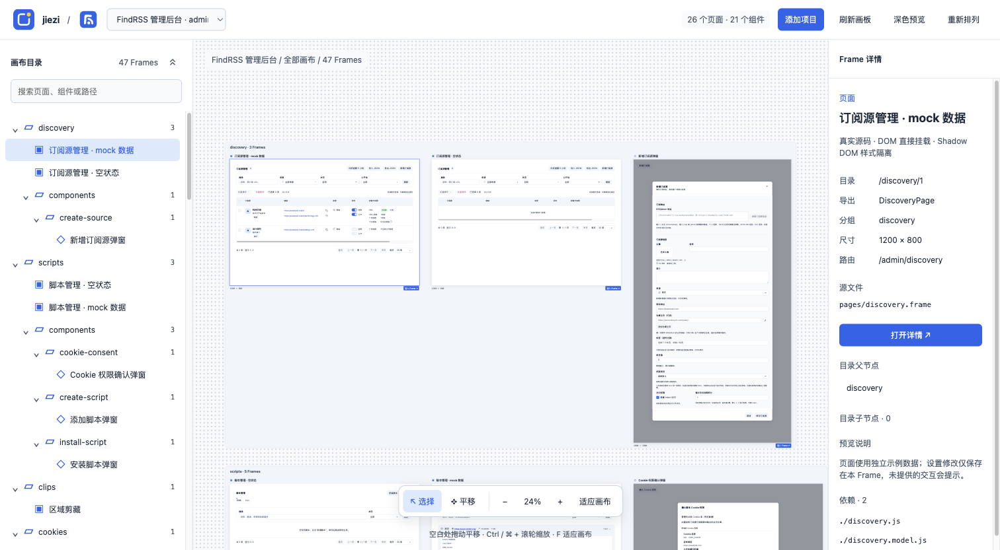
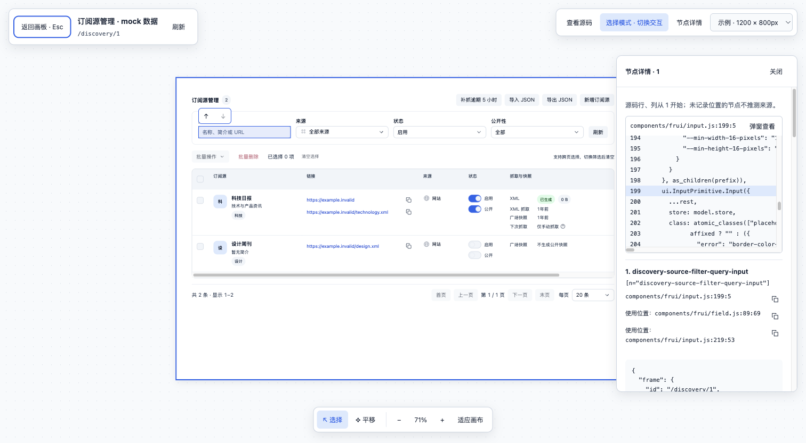

<p align="center" data-n="readme-brand">
  
</p>

# 芥子 · jiezi

**点选界面，让 Agent 精确知道改哪里。**

芥子是连接前端界面与编码 Agent 的本地白板。把页面、组件的各种状态提前展开在同一个画布上，无需手动走业务流程逐一触发；看到想改的内容，直接点选、获取源码位置，再连同修改要求交给 Agent，省去繁琐的位置描述，让 Agent 更快找到要改的代码。

[快速开始](#快速开始) · [使用白板](#使用白板) · [声明预览](#声明预览) · [使用指南](docs/guide.md)



*FindRSS 管理后台示例：26 个页面、21 个组件，展示 mock 数据、空状态和独立弹窗。*



*画布详情示例：选中搜索输入框，查看对应源码，复制源码位置后交给 Agent。*

## 为什么做芥子

我想调整页面上的某个内容，通常一眼就知道要改哪里。但把任务交给 Agent 时，却得描述「哪个页面、哪个弹窗、哪个区域里的哪个按钮」。遇到重复组件或不同状态，还要继续补充上下文，Agent 也得在源码里搜索、确认目标。一个简单的界面调整，往往先花时间解释「改哪里」。

而为了看到那个内容，可能还要先切页面、填表单、点开弹窗，才能进入目标状态。每次检查或修改，都要重复这些操作。

芥子把需要的页面、组件和状态预先摆在同一张画布上，让你直接看到目标，再通过点选获取对应源码及文件、行列位置。把位置与修改要求一起交给 Agent，就能用「源码位置 + 把按钮间距调大」这样的明确指令替代冗长的位置描述，减少双方寻找和确认目标的时间。

## 从界面到 Agent

1. **直接看到各种状态**：通过预览声明或适配器，将页面、组件、空状态、弹窗等分别展开，无需每次手动操作业务流程来复现。需要展示的状态与示例数据由接入时配置。
2. **点选要改的内容**：进入详情，点选单个内容或框选一组内容，查看对应源码及文件、行列位置，也可查看节点的使用位置。
3. **把准确位置交给 Agent**：点击源码位置旁的复制按钮，将位置连同修改要求粘贴给 Agent，让它直接定位要修改的代码。
4. **写标注并生成 Prompt**：选中节点后写下修改要求，标注会按 1、2、3… 编号并跟随节点；可用 `#n` 引用其他标注。点击底部「生成 Prompt」，复制整段 Markdown 交给 Agent。

画布也方便对照多个页面的样式；详情支持切换 1200 / 768 / 390px 宽度，检查不同屏幕下的布局。源码追踪的支持范围见[使用指南](docs/guide.md#节点源码追踪)。

每个预览（Frame）使用独立 ShadowRoot，隔离业务样式，支持浅色与深色主题，错误在各自 Frame 中展示。通过适配器接入多个本地项目后，可分别保存布局，并通过独立地址打开指定 Frame。

预览默认进入选择模式，用于展示和检查；详情工具栏可切换到交互模式，实际操作页面、输入和滚动，切换时保留页面状态。业务数据和依赖由适配器提供；内置示例可独立运行。

## 快速开始

需要 **Node.js 20+** 和 npm。在项目根目录运行：

```sh
npm ci
npm run dev
```

打开 [http://127.0.0.1:39980](http://127.0.0.1:39980)，即可看到内置的桌面首页、手机首页和计数器组件，无需配置外部项目。

源码变更后自动重建，刷新查看；也可点击「刷新画板」手动构建。修改适配器配置或服务脚本后需重启。服务只监听本机，不提供业务后端。

## 使用白板

| 操作 | 方式 |
| --- | --- |
| 平移画布 | 拖动空白处、滚轮，或按住空格拖动 |
| 缩放画布 | Ctrl / ⌘ + 滚轮，或底部缩放按钮 |
| 适应画布 | 按 `F` 或点击「适应画布」 |
| 移动 Frame | 拖动 Frame 标题 |
| 进入详情 | 双击 Frame 或目录条目；选中目录条目后按 Enter |
| 检查 DOM | 在详情中点选或框选；退出选择后可按 Alt / Option 临时选择 |
| 复制源码位置 | 在节点详情中点击源码位置旁的复制按钮，再粘贴给 Agent |
| 逐层退出 | 按 Esc 清除选区、退出选择、关闭源码面板或返回画板 |

详情中可切换设备宽度、查看源码和节点 JSON。「刷新」只更新画布内容，保留当前地址、视口和设备宽度；预览中的临时业务状态会重置。

更多行为见[画布操作](docs/guide.md#使用白板)和[源码追踪](docs/guide.md#节点源码追踪)。

## 声明预览

内置示例在 `examples/demo/views.frame` 中声明预览，文件内容是 JavaScript：

```js
import { CounterModel } from './counter.model.js';
import { CounterView } from './views.js';

export const _Preview = [
  {
    name: '计数器',
    path: '/home/components/counter',
    width: 390,
    height: 500,
    render() { return () => CounterView(CounterModel()); },
  },
];
```

`name` 是展示名称，`path` 是唯一身份并决定目录层级；`render()` 返回视图或创建视图的工厂，每次挂载可创建独立 Model。扫描时只读取元数据，不执行模块或渲染函数。

这是内置适配器使用的声明方式；其他项目的扫描和挂载由各自适配器负责。详见[预览声明规范](docs/guide.md#声明预览)。

## 开发与验证

项目采用原生 JavaScript、Model / View 分离、esbuild 构建，以及基于 Node.js 的测试。新增节点应提供明确的 `data-n` 语义标识，白板样式使用 [tokens.css](src/tokens.css)。

```sh
npm test
npm run build
```

默认测试使用项目内示例、临时文件和 Node DOM 模型。内置构建输出位于 `dist/demo/`；外部项目按适配器与源码目录区分输出，构建成功后原子替换。`dist/` 与 `node_modules/` 不提交。

外部业务集成测试单独运行，从本机 `project.json` 读取对应适配器的首个项目：

| 命令 | 验证对象 |
| --- | --- |
| `npm run test:integration` | 小讯适配器 |
| `npm run test:admin` | FindRSS 管理后台 |
| `npm run test:wx` | Download & Manage |

测试不执行浏览器布局引擎，实际排版、焦点、媒体和滚动裁切需人工验收。当前源码追踪支持 JavaScript 编译输入，TS / JSX、第三方运行时生成节点等限制见[源码追踪说明](docs/guide.md#节点源码追踪)。

提交问题时请附上适配器类型、复现步骤和错误信息；修改代码后运行默认测试与构建。项目约定见 [AGENTS.md](AGENTS.md)。

---

文档结构参考 [Best-README-Template](https://github.com/othneildrew/Best-README-Template) 与 [GitHub README 指南](https://docs.github.com/en/repositories/managing-your-repositorys-settings-and-features/customizing-your-repository/about-readmes)。
